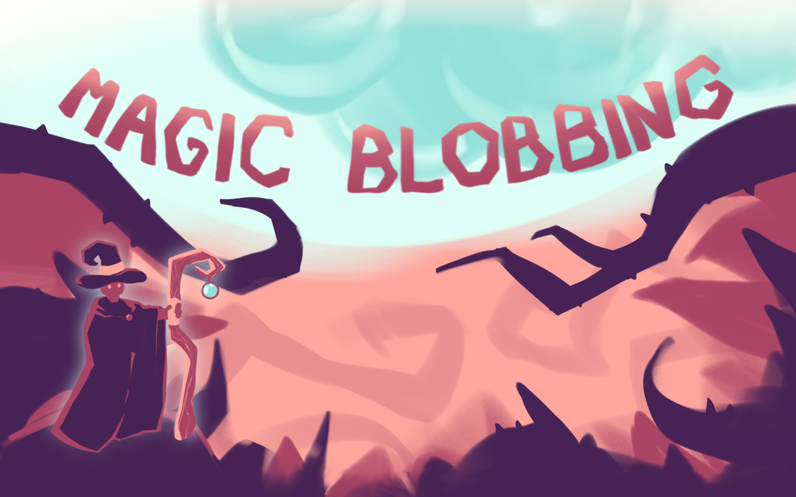
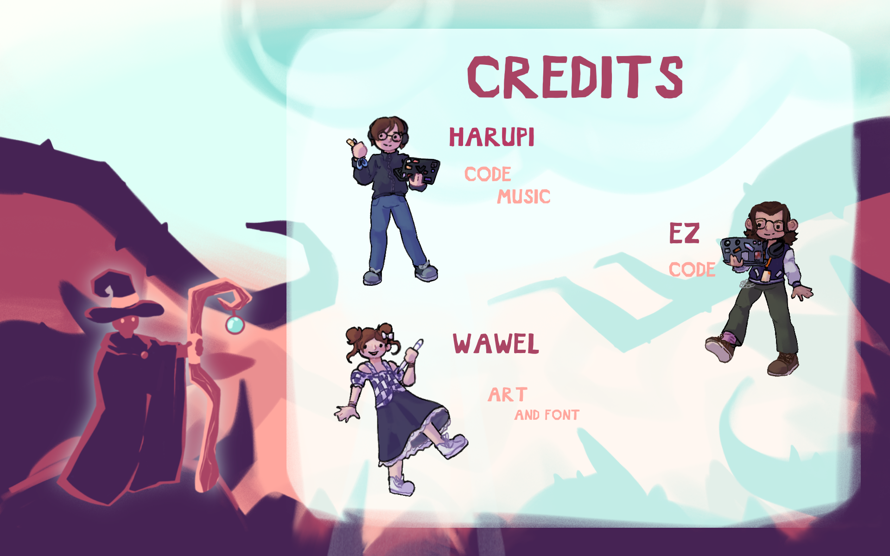

# Magic Blobbing

A pong-inspired game where you have to use slimes to enter an enchanting forest.

# Play

You can find the game on [itch.io](https://firn.itch.io/magic-blobbing) and play with arrow up, arrow down, and space.
Enjoy !

# Creation

This game was made with Godot during the [Haven](https://haven.hackclub.com/) game jam on 14th and 15th of November 2026.

# Credits

All of the code, the sounds and the assets were made with ❤️ by the 3 of us.

